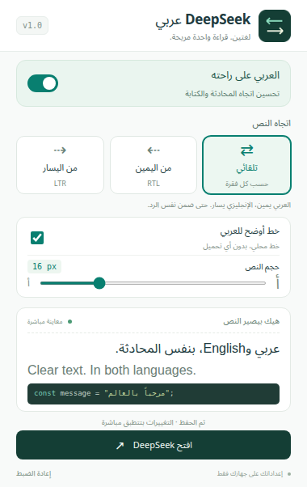

# DeepSeek عربي — RTL & LTR

إضافة مستقلة مفتوحة المصدر لـ Chrome وEdge لتحسين قراءة وكتابة العربي والإنجليزي في [DeepSeek](https://chat.deepseek.com/). فكرتها مشابهة لإضافة RTL/LTR Magic، والتنفيذ هنا جديد ومستقل. لا تحتاج حساباً إضافياً أو API key أو تثبيت مكتبات.

**الحالة: نسخة تجريبية v1.0.0، متاحة للتثبيت اليدوي، ولم تُنشر في متاجر الإضافات بعد.**

[تنزيل النسخة التجريبية](https://github.com/GhaithALEdlbi/deepseek-arabic/releases/tag/v1.0.0) · [الإبلاغ عن مشكلة](https://github.com/GhaithALEdlbi/deepseek-arabic/issues) · [سياسة الخصوصية](PRIVACY.md)

Arabic/English RTL & LTR support for DeepSeek chat: automatic paragraph direction, readable fonts, and local-only settings. Independent Manifest V3 extension for Chromium browsers. No runtime dependencies, tracking, or remote code.



## التثبيت خلال دقيقة

1. نزّل `deepseek-arabic-1.0.0.zip` من [صفحة الإصدار](https://github.com/GhaithALEdlbi/deepseek-arabic/releases/tag/v1.0.0) وفك الضغط. أو نزّل مصدر المستودع وافتحه.
2. في Chrome افتح `chrome://extensions`، أو في Edge افتح `edge://extensions`.
3. فعّل **Developer mode / وضع المطوّر**.
4. اضغط **Load unpacked / تحميل إضافة غير مضغوطة**.
5. اختَر مجلد `deepseek-arabic`؛ هو المجلد الذي يحتوي على `manifest.json` مباشرة.
6. افتح DeepSeek أو حدّث تبويبه إن كان مفتوحاً. ثبّت أيقونة الإضافة من قائمة الإضافات للوصول السريع للإعدادات.

لا تَختَر المجلد الأب، ولا ملف ZIP نفسه. حزمة `-store.zip` مخصصة لرفعها إلى المتجر؛ للتثبيت اليدوي استخدم الحزمة العادية. تنزيل مصدر GitHub قد ينتج مجلداً باسم `deepseek-arabic-main`، وداخله مجلد الإضافة `deepseek-arabic`.

## ماذا تفعل؟

- **تلقائي:** كل فقرة لها اتجاهها؛ العربي من اليمين والإنجليزي من اليسار. يدعم فقرات عربية تبدأ باسم إنجليزي مثل React أو API.
- **من اليمين / من اليسار:** فرض اتجاه واحد على النصوص، مع حماية اتجاه الأكواد والمعادلات.
- **الكتابة:** ضبط اتجاه مربع الكتابة أثناء الإدخال، سواء كان textarea أو محرراً قابلاً للتحرير.
- **قراءة أوضح:** خط Tahoma محلي مع بدائل، حجم من 14 إلى 22، وتباعد مريح بين الأسطر.
- **النص المختلط:** عزل الروابط والأكواد المضمّنة، وتحديد اتجاه مستقل لكل خلية في الجداول، مع إبقاء ترتيب الأعمدة الأصلي.
- **الردود الجديدة:** متابعة التعديلات أثناء ظهور الرد والتنقل بين المحادثات دون إعادة تحميل.
- **إيقاف مباشر:** زر التفعيل يزيل علامات الإضافة وتنسيقها، ويعيد عرض الموقع الأصلي. إعادة الضبط تعيد الإعدادات الافتراضية وتفعّل الإضافة.

نافذة الإعدادات تحتوي على معاينة محلية. التغييرات تُحفظ وتُطبق مباشرة على تبويبات DeepSeek التي حُمّلت فيها الإضافة. بعد التثبيت الأول أو تحديث ملفات الإضافة، أعد تحميل الإضافة من صفحة الإضافات وحدّث تبويبات DeepSeek.

## الخصوصية والصلاحيات

تعمل فقط على `https://chat.deepseek.com/*`. تستخدم صلاحية `storage` لحفظ أربعة إعدادات محلياً: التفعيل، الاتجاه، الخط، وحجم النص. لا تحفظ محتوى المحادثات ولا ترسله لأي جهة، ولا تحتوي على تحليلات أو خطوط خارجية أو اتصالات شبكة. تقرأ النص المعروض محلياً لتحديد اتجاهه، وتضيف سمات وتنسيقاً فقط دون تغيير النص أو إدراج علامات اتجاه خفية فيه. لا تحتاج صلاحيات الحافظة أو سجل التصفح أو جميع المواقع.

## الفحص والتطوير

ملفات الإضافة جاهزة مباشرة؛ Node.js وPython مطلوبان فقط لأوامر التطوير التالية:

```bash
npm test
npm run check
npm run package
```

الحزم الناتجة: `dist/deepseek-arabic-1.0.0.zip` للتثبيت اليدوي، و`dist/deepseek-arabic-1.0.0-store.zip` للمتجر، مع ملف `SHA256SUMS.txt` للتحقق من سلامة التنزيل. لا توجد تبعيات npm ولا خطوة build. لتوليد الأيقونات من جديد: `python3 scripts/make-icons.py` (يتطلب Pillow).

اختبار المتصفح موجود في `tests/browser-check.js` لتشغيله بأمر Playwright CLI `run-code --filename` داخل جلسة Chromium حُمّلت فيها الإضافة فعلياً. يستخدم صفحة محادثة تجريبية على عنوان DeepSeek عبر اعتراض محلي للطلب؛ ولا يرسل محادثة إلى الخدمة. راجع `tests/README.md` لطريقة تشغيله.

نتيجة التحقق بتاريخ 14 نوفمبر 2026: نجحت 9 مجموعات لاختبارات الاتجاه والإعدادات، و42 حالة تحقق داخل Chromium مع تحميل الإضافة الفعلية على محادثة تجريبية محلية.

## النشر والتعلم

- [خطوات نشر الإضافة للناس والمتاجر](docs/PUBLISHING.ar.md)
- [وصف المتجر وحقول الخصوصية الجاهزة](docs/STORE-LISTING.ar.md)
- [كيف تبني إضافة بنفسك، من الصفر](docs/LEARN-EXTENSIONS.ar.md)
- [مثال تعليمي صغير قابل للتجربة](examples/my-first-extension/)
- [مسودة بوست لينكدإن](docs/LINKEDIN-POST.ar.md)

للمساهمة: افتح Issue يصف المشكلة وخطوات تكرارها، أو أرسل Pull Request. لا تنشر نصوص محادثات خاصة؛ استخدم مثالاً مصطنعاً يوضح مشكلة الاتجاه.

## حدود التوافق

النسخة موجهة إلى Chrome وEdge على الكمبيوتر، وليست تطبيقاً للهاتف أو إضافة Firefox. كشف الاتجاه تلقائي وتقريبي؛ يمكن تغييره يدوياً عند الحاجة. الاتجاه في مربع الكتابة يُحدد على مستوى المربع، وفي الردود يُحدد لكل فقرة أو عنصر نصي. يستخدم التكامل محددات مكونات DeepSeek مثل `.ds-markdown` و`.ds-message` مع بدائل محدودة لرسائل المستخدم؛ قد تحتاج المحددات لتحديث إذا تغيّرت بنية الموقع.

تعذر اختبار محادثة حقيقية في هذه الجلسة لأن موقع DeepSeek أعاد HTTP 403 لمتصفح الاختبار. اختبار المتصفح المحلي يفحص تحميل الإضافة وصلاحياتها، والنص المختلط، والكتابة، والبث، والتنقل، والأكواد، والمعادلات، والجداول، والحفظ والتعطيل؛ ولا يثبت التوافق مع كل نسخة منشورة من واجهة DeepSeek.

هذا المشروع غير تابع لـ DeepSeek أو لمطوري RTL/LTR Magic. الترخيص MIT.
